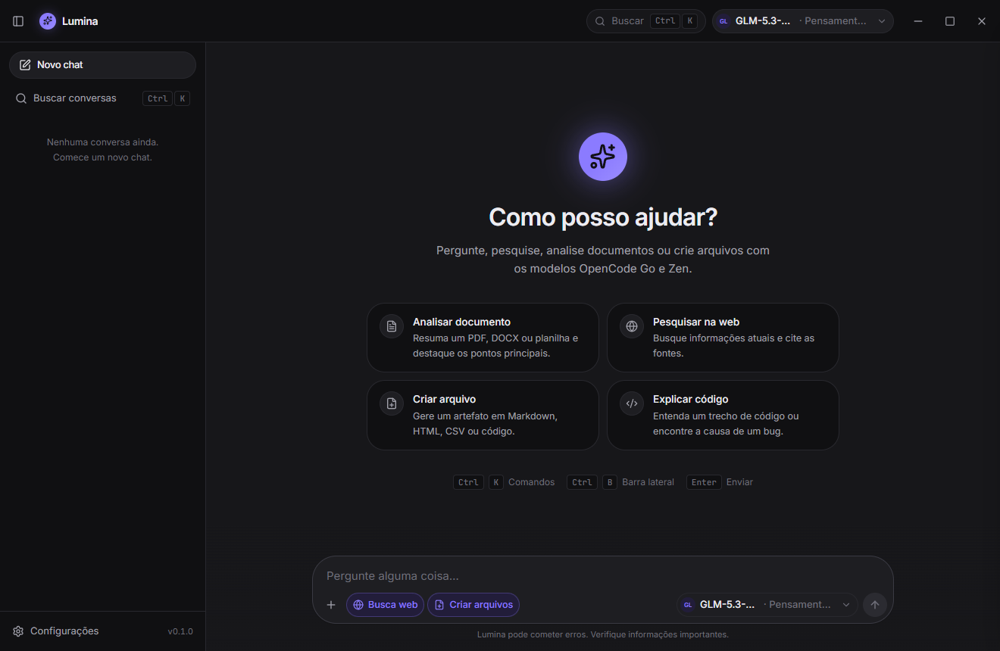
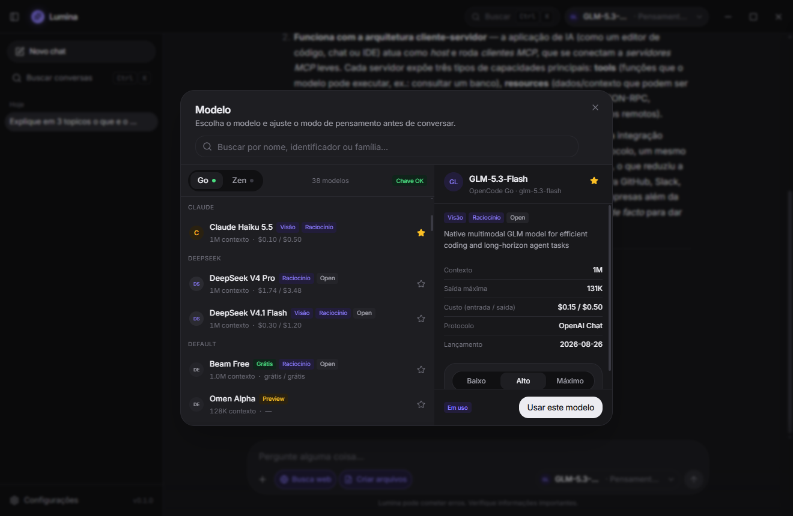
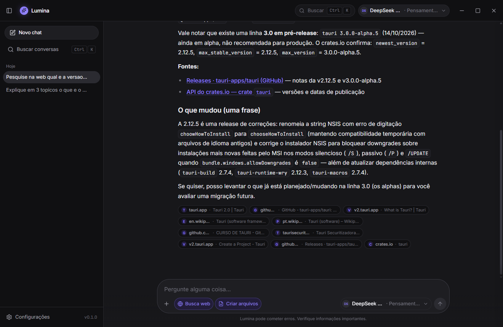
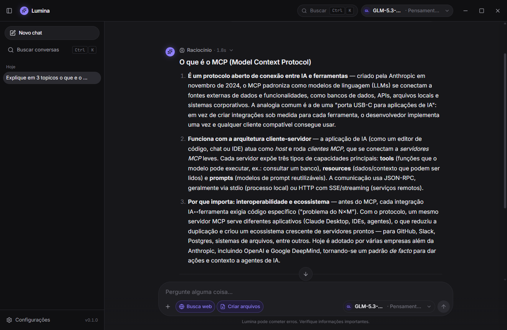

# Zylara

Chat desktop de IA construído com **Tauri 2 + React 19 + Tailwind CSS 4**, usando **OpenCode Go**, **OpenCode Zen**, **OpenAI** (plano ChatGPT via "Sign in with ChatGPT" ou API key) e **Anthropic** (API oficial, API key) como provedores.


## Funcionalidades

- **Conversas com streaming** em tempo real, com espaço de pensamento que mostra os passos do agente (raciocínio, buscas, páginas lidas e arquivos criados) numa timeline colapsável.
- **Escolha de modelo e modo de pensamento** por modelo (esforço, orçamento de tokens ou desligado), com catálogo de 160+ modelos dos provedores OpenCode, OpenAI e Anthropic.
- **Login com o plano ChatGPT**: "Continuar com ChatGPT" (OAuth oficial, Sign in with ChatGPT) usa o plano da sua conta para requisições elegíveis — sem API key; a lista de modelos é a da sua conta, com selo "Plano ChatGPT" e link para gerenciar o uso. A API key da OpenAI continua disponível como alternativa.
- **Análise de documentos**: PDF, DOCX, XLSX/CSV, PPTX, texto/código e imagens (visão).
- **Busca na web** com citações de fontes: chips na mensagem (até 8) e lista completa no painel lateral de fontes, com leitura de páginas.
- **Criação de arquivos** (artefatos) com cards compactos no chat, lista completa no painel lateral e "Salvar como…" nativo — Markdown, HTML, SVG, CSV, JSON e código.
- **Execução de código (opt-in)**: o agente escreve e roda scripts Python/Node num workspace isolado (timeout, limites e cancelamento) e entrega os arquivos gerados como artefatos — PDF, DOCX, XLSX, PPTX, imagens, áudio/vídeo e ZIP.
- **Biblioteca de artefatos para o agente**: o modelo pesquisa a biblioteca **do usuário (todas as conversas, inclusive os arquivos enviados pela página Biblioteca)** — nome, título da conversa e conteúdo textual, sem acentos — e lê qualquer arquivo como contexto em turnos seguintes, com extração de texto de PDF/DOCX/XLSX/PPTX, metadados/estrutura de imagem, ZIP e mídia, e paginação; a timeline mostra a pesquisa e a leitura, e cada resultado informa a conversa de origem.
- **Página Biblioteca**: item na sidebar acima de Skills que mostra **todos os seus arquivos** (criados pelo agente em qualquer conversa e enviados por você) em grade ou lista, com busca, filtros (favoritos, imagens, documentos, código, mídia), ordenação, miniaturas de imagem, prévia por tipo, favoritar, renomear, "Salvar como…", abrir e excluir. Os arquivos enviados ficam disponíveis ao agente como contexto.
- **Skills locais**: instruções em Markdown (`SKILL.md`) com scripts prontos (stdlib) que orientam o agente na geração de cada formato; dá para adicionar skills próprias na pasta de dados.
- **Detecção de skills de outros agentes**: lê automaticamente os repositórios padrão — `~/.agents/skills`, `~/.codex/skills`/`CODEX_HOME`, `~/.claude/skills` e `~/.config/opencode/skills`/XDG — somente leitura, com a origem na UI e opção de desativar.
- **Gerenciamento de skills**: item na barra lateral abre o painel para ver, ativar/desativar e excluir skills (o item pode ser escondido em Configurações → Ferramentas).
- **UI generativa no chat**: o modelo escreve componentes (cards, tabelas, gráficos, timelines, tabs…) renderizados com segurança.
- **Artefatos em painel lateral** com modos **lista** (todos os artefatos gerados, em cards compactos) e **prévia** por tipo: PDF (pdf.js, páginas/zoom), DOCX (HTML sandbox), XLSX (abas + grade), PPTX (slides), **imagens** (PNG/JPEG/GIF/WebP/AVIF/BMP/ICO com zoom/pan/transparência e TIFF convertido), **áudio/vídeo** com player nativo, **ZIP** com listagem de entradas, **Markdown renderizado**, **JSON em árvore**, **CSV/TSV** com delimitador detectado, **código com syntax highlight** em 30+ linguagens e **hexdump** para binários. Acima de 4 artefatos numa resposta, o chat mostra os primeiros e um botão **+ Ver todos** que abre a lista.
- **Histórico local** (SQLite), busca, fixar, renomear, exportar.
- **UI/UX** inspirada no ChatGPT: sidebar, composer flutuante, paleta de comandos, temas claro/escuro, atalhos.

## Screenshots

| Boas-vindas | Seletor de modelo |
| --- | --- |
|  |  |

| Busca na web com citações | Raciocínio + markdown |
| --- | --- |
|  |  |

## Requisitos

- Node.js 20+ e pnpm
- Rust (toolchain MSVC no Windows)
- WebView2 (Windows 10/11)
- Uma API key do [OpenCode Console](https://opencode.ai/console) (Go ou Zen). A chave existente do OpenCode CLI é detectada automaticamente.
- Para OpenAI: uma conta ChatGPT elegível (botão **Continuar com ChatGPT** em Configurações → Provedores, sem API key) **ou** uma API key `sk-…` da plataforma.
- Para Anthropic: uma API key `sk-ant-…` do [Claude Console](https://platform.claude.com/settings/keys) (a API oficial é pay-as-you-go; não usa assinatura). A variável `ANTHROPIC_API_KEY` também é detectada.
- **Opcional**: Python 3.9+ (e/ou Node) para execução de código. Os helpers das skills usam somente a stdlib; pacotes como `python-docx`, `openpyxl` e `Pillow` melhoram o resultado quando instalados (a tela Configurações → Ferramentas mostra o ambiente detectado).

## Desenvolvimento

```bash
pnpm install
pnpm app:dev        # Tauri + Vite com HMR
```

Versão local (interativo, sem build) — todas as plataformas usam a mesma
versão:

```powershell
.\scripts\bump-version.ps1          # menu patch/minor/major/personalizada
.\scripts\bump-version.ps1 -Minor   # atalho
```

Atualiza `package.json`, `src-tauri/Cargo.toml`, `src-tauri/tauri.conf.json`,
`src/lib/appVersion.ts` e `src-tauri/Cargo.lock`. O equivalente cross-platform é
`pnpm version:set 0.2.0`.

Vetores e ícones da marca (a partir de `assets/Zylara_Logo.svg`):

```bash
pnpm brand
```

Regera `public/brand/*.svg`, o master `app-icon.png`, `src-tauri/icons` com fundo
transparente no Windows/Linux e o `icon.icns` do macOS com o tile grafite-claro.

Build de produção e instalador (script único, sempre com a build mais recente):

```bash
pnpm installer                 # detecta a plataforma atual
pnpm installer --dry-run       # valida versão, git e assets sem compilar
```

Saída em `release/<versão>/`: `Zylara-Setup-<versão>-windows-x64.exe` no
Windows; `.dmg` no macOS; `.deb`/`.rpm`/`.AppImage` no Linux, com
`SHA256SUMS.txt` e `release.json`. Linux x64 e macOS arm64 recebem também
`Zylara-install-<versão>-linux-x64.sh`/`Zylara-install-<versão>-macos-arm64.sh`,
que instalam por usuário em `~/.local/opt/zylara/Zylara.AppImage` e
`~/Applications/Zylara.app`. O instalador do Windows tem UI própria
(dark), escopo por usuário ou para todos, atalhos, atualização, desinstalação e
remoção opcional dos dados. A instalação leva também o desinstalador
(`Uninstall Zylara.exe`, mesma UI, inglês por padrão) para dentro da pasta do
app, com entrada em Aplicativos e recursos e atalho no Menu Iniciar; macOS e
Linux usam os formatos nativos (ou o script gerenciado). Detalhes, flags e
assinatura: [`docs/INSTALLER.md`](docs/INSTALLER.md).

Release de produção: um push na `main` com uma versão nova no `package.json`
dispara `.github/workflows/installer.yml` automaticamente. O workflow compila
Windows/macOS/Linux, cria a tag `v<versão>` e publica a release. Push sem bump
de versão não compila nada (a mesma versão é ignorada); uma versão menor falha.
Também é possível rodar manualmente em **Actions → Release** (input `draft`,
útil para republicar a mesma versão).

O app instalado consulta automaticamente essas releases (ao abrir e a cada hora
enquanto estiver aberto) e mostra um aviso na barra de título quando há uma
versão estável mais nova. O download é verificado por SHA-256 e a instalação usa o instalador da
plataforma, sempre com confirmação — no Windows, o app fecha e o wizard do
Zylara abre para concluir a instalação. No Linux
x64/macOS arm64, uma instalação feita pelo script gerenciado mostra **Instalar e
reiniciar** depois do download verificado; o app fecha, substitui o próprio
payload e reabre. Fechar o app, reiniciar ou baixar sem clicar não instala.
Instalações manuais continuam abrindo o DMG/pacote. A
verificação manual fica em **Configurações → Sobre → Atualizações**. Detalhes:
[`docs/INSTALLER.md`](docs/INSTALLER.md) §9.

Somente o executável (sem instalador):

```bash
pnpm tauri build --no-bundle   # src-tauri/target/release/zylara.exe
```

## Testes

O projeto é verificado por testes automatizados (TDD), sem automação de UI:

```bash
pnpm test                                     # Vitest: utils, catálogo, UI generativa, store do chat, timeline, previews de artefatos
cd src-tauri && cargo test --lib              # Rust: providers, harness, tools, documents, db, comandos
```

Testes de integração que chamam o gateway real ficam marcados como `#[ignore]` e usam
`deepseek-v4.1-flash` (OpenCode Go) com esforço máximo:

```bash
cd src-tauri
cargo test --lib providers::smoke -- --ignored --nocapture --test-threads=1
# Exige ANTHROPIC_API_KEY no ambiente; sem a chave o teste dá skip sem tocar a rede:
cargo test --lib providers::smoke::anthropic_direct -- --ignored --nocapture
cargo test --lib tools::web_search::tests::live -- --ignored --nocapture
cargo test --lib tools::fetch_url::tests::live -- --ignored --nocapture
```

## Estrutura

```
data/catalog.json        catálogo de modelos (gerado)
scripts/                 geração do catálogo e sondagens dos provedores
assets/                  logo oficial (`Zylara_Logo.svg`) e masters do ícone (`app-icon.svg`/`app-icon.png`); `pnpm brand` regenera vetores e src-tauri/icons
public/brand/            vetores da marca usados na UI, no favicon e no instalador
src/                     renderer React (componentes, stores, genui)
src-tauri/src/           core Rust (providers, harness, tools, documents, db)
src-tauri/skills/        skills embutidas (SKILL.md + scripts stdlib)
docs/                    arquitetura, design, modelos, arquivos/código e screenshots
```

Documentação: [Arquitetura](docs/ARCHITECTURE.md) · [Instalador](docs/INSTALLER.md) · [Arquivos, código e skills](docs/FILES.md) · [Design](docs/DESIGN.md) · [Modelos & Provedores](docs/MODELS.md).

## Privacidade

Conversas, anexos e artefatos ficam apenas na sua máquina. As API keys são armazenadas localmente (`secrets.json` no app-data) e nunca são expostas ao renderer. Requisições vão direto para o provedor escolhido (gateway do OpenCode, API da OpenAI ou API da Anthropic); nada passa por um servidor do Zylara.

## Natureza do projeto

O Zylara é um projeto de código aberto (open source), mantido sem fins lucrativos. Essa declaração descreve a finalidade do projeto e não restringe os direitos concedidos pela licença MIT.

## Licença

MIT ([LICENSE](LICENSE)).
